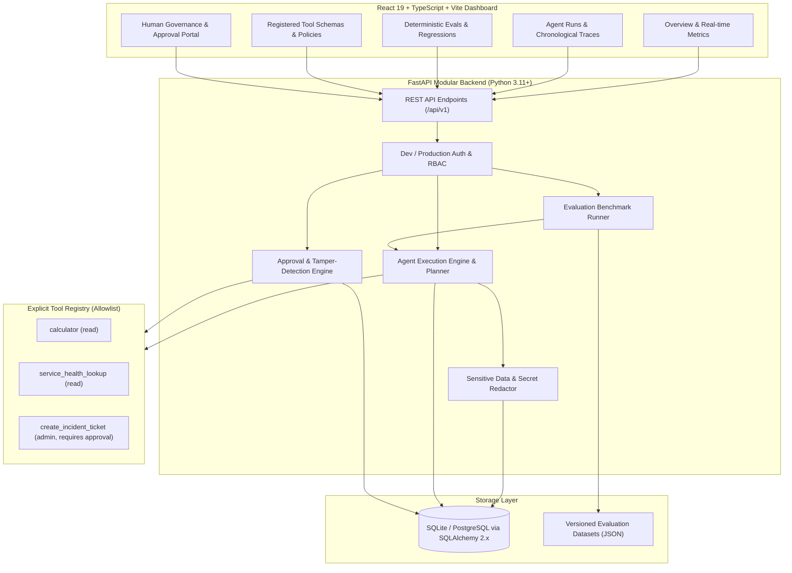

# Virar AI — Agent Observability, Evaluation, Reliability, and Governance Platform

[](LICENSE)
[](https://fastapi.tiangolo.com)
[](https://react.dev)
[](https://www.typescriptlang.org)

**Virar AI** is a modular engineering platform for observing, evaluating, debugging, and governing AI agents. It delivers chronological execution traces, human-in-the-loop approvals for protected actions, deterministic evaluation suites, latency tracking, cryptographic parameter verification, and automated secret redaction.

---

## 1. Core Architecture



---

## 2. Feature Implementation Status

| Feature | Status | Notes |
| :--- | :--- | :--- |
| **Agent Execution Engine** | **Implemented** | Deterministic planner, tool execution bounds, step limits, latency timing. |
| **Trace & Observability** | **Implemented** | Chronological event spans (`run_created`, `planning`, `tool_call`, `tool_result`, `completion`, `failure`). |
| **Human-in-the-Loop Governance** | **Implemented** | Protected actions pause for human review; prevents self-approval (`403 Forbidden`). |
| **Integrity & Anti-Tamper** | **Implemented** | SHA-256 parameter fingerprinting prevents parameter modification between approval and execution. |
| **Duplicate Execution Protection** | **Implemented** | Decided approvals cannot be approved or rejected multiple times (`400 Bad Request`). |
| **Sensitive Data Redaction** | **Implemented** | Regex scanner automatically sanitizes API keys, bearer tokens, and secrets from traces before persistence. |
| **Deterministic Eval Suite** | **Implemented** | 20-case test suite covering normal operations, boundary errors, outages, injection resistance, and approvals. |
| **Interactive Dashboard** | **Implemented** | Built with React 19, TypeScript, and Vite. Displays metrics, traces, evals, and approvals across 6 views. |
| **PostgreSQL Support** | **Implemented** | SQLAlchemy 2.x async engine configured for SQLite locally, switchable via `DATABASE_URL`. |
| **Real LLM SDK Provider** | **Architecture Ready** | Provider adapter interface designed (`LLM_PROVIDER`); default execution is deterministic and offline-capable without paid API keys. |

---

## 3. Quickstart & Local Setup (Windows PowerShell & Bash)

### Prerequisites
- Python 3.11+
- Node.js 18+ and npm

### Backend Setup (PowerShell)
```powershell
# Navigate to backend
cd backend

# Create & activate a virtual environment (optional but recommended)
python -m venv .venv
.\.venv\Scripts\Activate.ps1

# Install dependencies
python -m pip install -r requirements.txt greenlet

# Start the FastAPI server
python -m uvicorn app.main:app --host 127.0.0.1 --port 8000 --reload
```
Interactive API Documentation and OpenAPI Swagger UI: `http://127.0.0.1:8000/docs`

### Frontend Setup (PowerShell)
In a separate terminal:
```powershell
cd frontend
npm install
npm run dev
```
Open your browser at `http://localhost:5173` to launch the **Virar AI** Engineering Dashboard.

---

## 4. Running Automated Tests & Builds

### Backend Automated Test Suite (11 Tests)
```powershell
cd backend
python -m pytest tests/test_platform.py -v -c pytest.ini
```

### Frontend Production Build
```powershell
cd frontend
npm run build
```

---

## 5. Security & Governance Posture

- **Threat Model:** Comprehensive threat analysis covering prompt injection, approval bypass, TOCTOU argument tampering, and secret leakage is documented in [`docs/threat-model.md`](docs/threat-model.md).
- **Audit & Verification:** All metrics formulas, authorization rules, and regression tests are verified in [`docs/verification-report.md`](docs/verification-report.md).
- **Offline & Safe:** Designed with safe defaults—no arbitrary shell execution, no paid API requirements for testing, and zero external credential leakage.

---

## 6. License
This project is licensed under the MIT License - see the [LICENSE](LICENSE) file for details.
