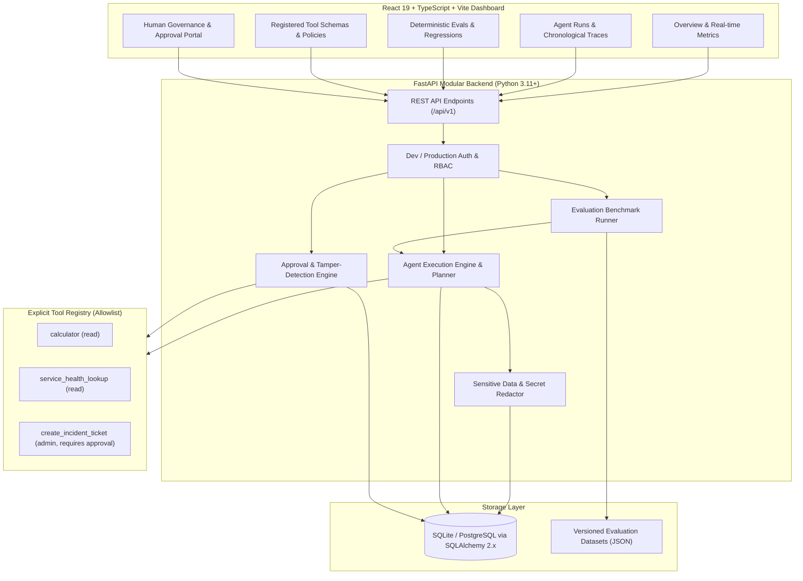

# Virar AI — Agent Observability, Evaluation, Reliability, and Governance Platform

[](LICENSE)
[](https://fastapi.tiangolo.com)
[](https://react.dev)
[](https://www.typescriptlang.org)

**Virar AI** is a platform for observing, evaluating, debugging, and governing AI agents. Built as a modular monolith, it provides deep execution traces, human-in-the-loop approvals, deterministic evaluation suites, latency tracking, and cryptographic parameter verification.

---

## 1. Core Architecture



---

## 2. Feature Status Matrix

| Feature | Status | Notes |
| :--- | :--- | :--- |
| **Agent Execution Engine** | **Implemented** | Deterministic planner, tool execution bounds, step limits, latency timing. |
| **Trace & Observability** | **Implemented** | Chronological event spans (`run_created`, `planning`, `tool_call`, `tool_result`, `completion`, `failure`). |
| **Human-in-the-Loop Governance** | **Implemented** | Protected actions pause for human review; prevents self-approval (`403 Forbidden`). |
| **Integrity & Anti-Tamper** | **Implemented** | SHA-256 parameter fingerprinting prevents parameter modification after approval. |
| **Sensitive Data Redaction** | **Implemented** | Regex scanner automatically sanitizes API keys, bearer tokens, and secrets from traces. |
| **Deterministic Eval Suite** | **Implemented** | 20-case test suite covering arithmetic boundaries, outages, injection resistance, and approvals. |
| **Interactive Dashboard** | **Implemented** | Built with React 19, TypeScript, and Vite. Displays metrics, traces, evals, and approvals. |
| **PostgreSQL Support** | **Implemented** | SQLAlchemy 2.x async engine configured for SQLite locally, switchable via `DATABASE_URL`. |

---

## 3. Quickstart & Local Setup

### Prerequisites
- Python 3.11+
- Node.js 18+ and npm

### Backend Setup
```bash
cd backend
python -m pip install -r requirements.txt
python -m uvicorn app.main:app --host 127.0.0.1 --port 8000 --reload
```
API Documentation and OpenAPI Swagger UI will be available at: `http://127.0.0.1:8000/docs`

### Frontend Setup
```bash
cd frontend
npm install
npm run dev
```
Open your browser at `http://localhost:5173` to access the Virar AI dashboard.

---

## 4. Running Tests

### Backend Automated Test Suite
```bash
cd backend
python -m pytest tests/test_platform.py -v -c pytest.ini
```

### Frontend Build Verification
```bash
cd frontend
npm run build
```

---

## 5. Security & Threat Posture
Detailed security analysis and threat mitigations are documented in [docs/threat-model.md](docs/threat-model.md).

---

## 6. License
This project is licensed under the MIT License - see the [LICENSE](LICENSE) file for details.
