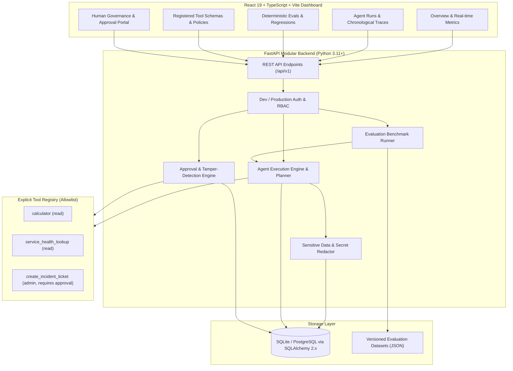

# Architecture & System Design — Virar AI

## 1. Overview
**Virar AI** is a modular platform for observing, evaluating, debugging, and governing AI agents. It captures real agent interactions, persists granular chronological execution traces, enforces human-in-the-loop approvals for consequential actions, and runs deterministic benchmark evaluation suites.

## 2. High-Level Architecture Diagram

## 3. Core Modules
- **Agent Execution Engine (`app/agent/runner.py`)**: Executes tasks, handles step limits and timeouts, formats trace spans, and records real token usage and cost metrics.
- **Trace & Observability (`app/models/entities.py`)**: Stores chronological spans (`run_created`, `planning`, `tool_call`, `tool_result`, `approval_requested`, `approval_decided`, `completion`, `failure`).
- **Tool Allowlist & Registry (`app/tools/base.py`, `app/tools/implementations.py`)**: Explicit allowlist preventing arbitrary code or unregistered shell invocation.
- **Governance & Approval System (`app/security/governance.py`)**: Cryptographic SHA-256 parameter hashing prevents argument tampering. Self-approval is strictly forbidden.
- **Deterministic Evaluation Suite (`app/evaluations/runner.py`)**: Runs 20 unit benchmarks testing arithmetic limits, zero-division, service outages, injection resistance, and unknown tools.
